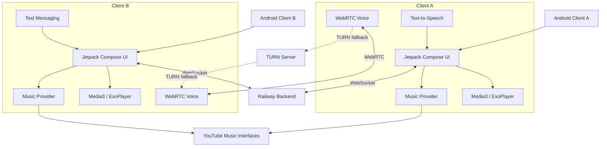

# Listen Together
## Software Requirements Specification (SRS)

**Version:** 2.0  
**Platform:** Android  
**Primary users:** Two private users  
**Application type:** Private, synchronized music and communication application  
**Distribution:** Direct APK installation; public Play Store distribution is not required.

---

# 1. Product Overview

Listen Together is a private Android application that allows two people to listen to the same music simultaneously while communicating through live voice and text.

Both users install the application and join the same room. Each device independently retrieves and plays the selected music. A lightweight backend synchronizes playback actions and manages communication between the devices.

The application also provides an asymmetric communication feature:

- User A speaks through their microphone.
- User B hears User A's voice live.
- User B communicates through text.
- User A's phone automatically reads User B's messages aloud using Android Text-to-Speech.

The application should minimize the need to interact with the screen while listening or communicating.

## 1.1 Core Product Principles

1. Both users have equal playback permissions.
2. Music plays locally on each device.
3. The backend coordinates playback but does not stream music.
4. Music and communication must continue when the application is minimized.
5. A room remains active while at least one participant is inside it.
6. Chat belongs to a room session and is not permanently archived.
7. The application must not require users to install additional music or communication applications.

---

# 2. System Architecture

## 2.1 High-Level Architecture

The system consists of two Android clients and one hosted backend.

### Android clients

Each client handles:

- User interface.
- Music search and track selection.
- Music stream resolution.
- Local music playback.
- Playback synchronization.
- Shared queue operations.
- Microphone capture.
- Incoming voice playback.
- Text messaging.
- Automatic TTS.
- Room membership and reconnection.
- Background media services.

### Hosted backend

The backend handles:

- Room creation and membership.
- WebSocket connections.
- Playback event distribution.
- Shared queue and playback state.
- Text message forwarding.
- Room-session lifecycle.
- WebRTC signaling.
- Reconnection and state recovery.

### External music source

The music integration follows an OpenTune-style architecture:

- YouTube Music is the intended catalogue source.
- YouTube Music-compatible interfaces are used for catalogue search and metadata.
- An extractor component resolves selected tracks into playable audio streams.
- Media3 / ExoPlayer handles local playback.
- Each client independently resolves and plays the selected track.

The music provider implementation must remain isolated from the synchronization system.

## 2.2 Architecture Diagram



The music stream must travel directly from its source to the corresponding Android device. It must not pass through the Railway backend.

---

# 3. Room and Session Management

## FR-01: Room Creation and Joining

- Either user can create a room.
- The other user can join through a private invitation or room identifier.
- A room supports exactly two participants.
- Both users must be members of the same room to synchronize playback.
- Room access must be restricted to the intended participants.
- The application should remember the room identifier to make reconnecting easier.

## FR-02: Room Lifecycle

A room remains open as long as at least one participant remains inside it.

**Required behavior:**

| Event | Expected result |
|---|---|
| Both users join | New session begins |
| User A leaves | Room remains active |
| User B remains inside | Playback and chat session remain active |
| User A rejoins | Existing session resumes |
| Both users leave | Session closes |
| Both users join again | New session begins |

Leaving and closing a session are separate operations.

### Session closure

- A participant leaving must not close the room.
- The remaining participant can continue listening.
- A returning participant rejoins the existing session.
- When both participants explicitly leave, the session closes.
- A new session must start with an empty chat.
- Previous session messages must not reappear.

### Unexpected disconnections

A temporary network interruption must not immediately close the room.

The backend should:

- Mark the disconnected participant as temporarily disconnected.
- Retain their membership during a configurable reconnection grace period.
- Allow them to reconnect to the existing session.
- Close the session only when both participants have left or their disconnection grace periods have expired.

The application must distinguish between an intentional leave and an unexpected connection loss.

## FR-03: Room State

The backend maintains:

- Room identifier.
- Session identifier.
- Participant identifiers.
- Participant connection status.
- Current track.
- Playback status.
- Playback position and timestamp.
- Shared queue.
- Queue revision.
- Session creation time.
- Session activity status.

The session identifier must change when a new session begins, even if the room identifier remains the same.

---

# 4. Music Catalogue and Playback

## FR-04: Music Provider Integration

The application will use an OpenTune-style music integration.

### Catalogue source

YouTube Music is the intended catalogue source.

### Search and metadata

The music provider module must support:

- Track search.
- Artist information.
- Album information.
- Track thumbnails.
- Duration.
- Track identifiers.
- Playlist or album information where available.

Search results should display:

- Track title.
- Artist.
- Album, when available.
- Thumbnail.
- Duration.

### Stream resolution

When a user selects a track:

1. The application obtains the track identifier and metadata.
2. The music provider module resolves the track.
3. The resolver obtains an available audio stream.
4. Media3 / ExoPlayer loads the resolved stream.
5. Playback begins locally.

The provider module must handle:

- Unavailable tracks.
- Failed resolution.
- Expired stream URLs.
- Network errors.
- Unsupported formats.
- Resolution retries.

The application should refresh an expired stream URL without changing the selected track.

### Important architectural requirement

Catalogue search, metadata retrieval, stream resolution, and playback must be separate components.

The room synchronization system must not depend on the internal implementation of the music extractor.

The music integration should be replaceable without rewriting the playback synchronization system.

## FR-05: Music Playback

Each Android device independently plays the selected track.

Playback engine:

- AndroidX Media3.
- ExoPlayer.
- Android MediaSession integration.

Required controls:

- Play.
- Pause.
- Seek.
- Next track.
- Previous track.
- Repeat.
- Shuffle.
- Volume through system audio controls.

The playback interface should display:

- Track title.
- Artist.
- Album artwork.
- Current position.
- Total duration.
- Playback progress.
- Play/pause control.
- Previous/next controls.
- Queue access.

Both clients must play the same recording whenever that recording is available to both.

## FR-06: Playback Synchronization

Both users have equal control over playback.

An action performed by either user must be propagated to the other device.

### Supported events

| Event | Purpose |
|---|---|
| PLAY | Start playback |
| PAUSE | Pause playback |
| SEEK | Change playback position |
| TRACK_CHANGE | Select another track |
| QUEUE_ADD | Add a track |
| QUEUE_REMOVE | Remove a track |
| QUEUE_REORDER | Change queue order |
| REPEAT_CHANGE | Change repeat mode |
| SHUFFLE_CHANGE | Change shuffle mode |

### Event generation

- The device where the action originates generates the event.
- The event is sent to the backend through WebSocket.
- The backend validates and forwards it.
- The receiving client applies the event to its local player.
- Applying a remote event must not generate another outgoing event.

### Event structure

Every playback event should contain:

- Event identifier.
- Room identifier.
- Session identifier.
- Sender identifier.
- Event type.
- Event sequence number.
- Client timestamp.
- Event payload.

Playback events must be associated with the active session so that events from an old session cannot affect a new one.

### Playback synchronization strategy

The backend maintains an authoritative shared playback state.

For example:

```json
{
  "session_id": "session-id",
  "track_id": "provider-track-id",
  "is_playing": true,
  "position_ms": 85000,
  "updated_at": 1794050000000,
  "revision": 24
}
```

The actual state should also include the queue and relevant playback settings.

The timestamp allows a receiving client to estimate the expected current playback position.

If the backend reports a playing position of 85 seconds and the message arrives 2 seconds later, the receiving client should account for those 2 seconds when starting playback.

### Simultaneous actions

If both users perform playback actions nearly simultaneously:

- The backend must serialize accepted events.
- Each accepted event receives a monotonically increasing room revision.
- Clients must reject duplicate or stale events.
- The latest accepted event determines the shared state.

### Drift correction

The application should periodically compare both clients' playback positions.

If the difference exceeds a configurable threshold:

- Apply a small seek correction.
- Avoid unnecessary large jumps.
- Account for buffering and network latency.
- Avoid repeated corrections that make playback unstable.

### Reconnection

When a client reconnects:

- It receives the latest session state.
- It retrieves the current track if necessary.
- It restores the correct queue.
- It resumes at the expected playback position.
- It ignores events belonging to an older session.

---

# 5. Shared Queue

## FR-07: Queue Management

Both users can modify the shared queue.

Supported operations:

- Add a track.
- Remove a track.
- Reorder tracks.
- Play a queued track.
- Skip to the next track.
- Return to the previous track.
- Clear the queue.

### Queue requirements

- Queue changes must synchronize between devices.
- The backend maintains the canonical queue.
- Every queue modification updates the queue revision.
- Both clients display the same queue order.
- Queue changes must survive a participant leaving and rejoining the same session.
- Queue state is cleared when the room session closes.

### Automatic progression

When a track finishes:

- The active client determines the next track according to queue and playback settings.
- The resulting track change is synchronized.
- Both clients resolve and play the next track.

The implementation must prevent both devices from independently advancing the queue and generating duplicate track-change events.

---

# 6. Communication

## FR-08: Text Messaging

Both users can exchange text messages.

### Message behavior

- Messages are sent through the backend.
- Messages are delivered to the other connected participant.
- Messages appear in the active room chat.
- Messages include sender, content, and timestamp.
- Messages should be ordered by server-assigned sequence.
- Delivery should be retried or acknowledged when appropriate.

### Session-scoped persistence

Chat history exists only for the active room session.

| Situation | Chat behavior |
|---|---|
| User A sends a message | Stored in active session |
| User B leaves | Messages remain |
| User B rejoins | Existing messages are available |
| User A leaves | Messages remain |
| Both leave | Session chat is cleared |
| New session starts | Empty chat |

No permanent chat archive is required.

The backend must not retain closed-session messages as a normal application feature.

## FR-09: Automatic Text-to-Speech

The application must automatically read incoming messages from User B on User A's phone.

### Required behavior

1. User B types and sends a message.
2. The backend forwards the message.
3. User A's phone receives it.
4. Android TextToSpeech converts it into speech.
5. The message is played through User A's audio output.

### Requirements

- TTS must run locally on User A's device.
- No external AI or speech-generation API is required.
- Incoming messages should be spoken automatically.
- Messages must be spoken in their received order.
- Multiple messages must be queued rather than played simultaneously.
- TTS should support pause, resume, and stop.
- The application should avoid reading messages that have already been processed after reconnection.
- A setting should allow TTS to be disabled or muted.

Text messages should remain visible in the chat even when spoken aloud.

## FR-10: Live Voice Communication

The application supports live voice transmission from User A to User B.

### User A

- User A can activate and deactivate the microphone.
- The application captures microphone audio.
- Audio is transmitted live.
- No speech transcription is performed.
- No AI voice processing is required.

### User B

- Receives User A's live voice.
- Hears it through the phone's audio output.
- Can mute incoming voice if needed.

### Initial direction

Voice communication is one-way:

**User A → User B**

User B communicates through text, which is automatically spoken by User A's phone.

The implementation should not require a full two-way calling interface.

### Voice transport

Use WebRTC for live voice.

- WebRTC handles media transport.
- Railway handles signaling.
- STUN servers assist with NAT traversal.
- TURN provides relay fallback when a direct connection cannot be established.
- Voice media should use WebRTC's encrypted transport.

The application should handle:

- Microphone permissions.
- Connection establishment.
- Reconnection.
- Microphone mute.
- Incoming audio mute.
- Audio routing.
- Network interruptions.

---

# 7. Audio Management

## FR-11: Simultaneous Music and Communication

Music, incoming voice, and TTS must coexist.

### Required behavior

- Music continues during voice communication.
- Incoming voice must remain intelligible.
- TTS messages must be audible over music.
- Audio focus and ducking must be handled.
- The user must be able to adjust device volume normally.
- Bluetooth and wired headphone output must work.

### Priority

The recommended initial audio priority is:

1. Incoming live voice.
2. TTS messages.
3. Background music.

When voice or TTS becomes active, music should duck rather than necessarily stop.

The exact ducking levels and behavior should be configurable during testing.

### TTS and voice overlap

The application should avoid playing TTS and incoming voice simultaneously at full volume.

If a message arrives while live voice is active:

- Queue the TTS message.
- Speak it when voice activity ends or after a suitable pause.
- Preserve message order.

---

# 8. Background Operation

## FR-12: Background Music Playback

Music playback must continue when:

- The application is minimized.
- The screen is locked.
- The user switches to another application.
- The device is connected to Bluetooth headphones.

Implementation:

- Media3 MediaSession.
- MediaSessionService or an appropriate foreground media service.
- Persistent media notification.
- Notification playback controls.
- Appropriate Android foreground-service declarations.

The playback service must survive normal activity destruction and configuration changes.

## FR-13: Background Voice Communication

Live voice communication should continue while the application is minimized or the screen is locked.

The application must:

- Maintain the WebRTC connection where Android permits.
- Use appropriate foreground-service behavior.
- Show an active communication notification.
- Handle microphone foreground-service permissions.
- Restore the communication state after temporary interruptions.

If the operating system terminates the process, the application should recover the room and session state when reopened.

Background execution must respect Android's foreground-service and microphone-access restrictions.

---

# 9. Backend Specification

## FR-14: Backend Responsibilities

The backend is a coordination service, not a music player.

It must provide:

### Room management

- Create room.
- Join room.
- Leave room.
- Track participant status.
- Maintain active session.
- Close session when both participants have left.

### Playback synchronization

- Receive playback events.
- Validate active session.
- Serialize events.
- Maintain authoritative playback state.
- Forward events to the other client.
- Maintain shared queue.
- Support state recovery.

### Communication

- Forward text messages.
- Maintain session-scoped chat.
- Exchange WebRTC signaling messages.

### Reconnection

- Track connection status.
- Apply a reconnection grace period.
- Restore active session state.
- Reject messages from expired sessions.

## FR-15: Backend Non-Responsibilities

The backend must not:

- Play music.
- Proxy music audio streams.
- Download music.
- Decode music.
- Generate TTS audio.
- Transcribe voice.
- Process microphone audio.
- Require another application on either phone.

## FR-16: Backend API and WebSocket Events

The exact API framework is an implementation decision.

Suggested REST endpoints:

| Method | Endpoint | Purpose |
|---|---|---|
| POST | /rooms | Create room |
| POST | /rooms/{id}/join | Join room |
| POST | /rooms/{id}/leave | Leave room |
| GET | /rooms/{id}/state | Retrieve room state |
| GET | /rooms/{id}/session | Retrieve active session |

Suggested WebSocket event types:

```text
ROOM_JOINED
ROOM_LEFT
PARTICIPANT_STATUS
SESSION_STARTED
SESSION_CLOSED

PLAY
PAUSE
SEEK
TRACK_CHANGE

QUEUE_ADD
QUEUE_REMOVE
QUEUE_REORDER

PLAYBACK_STATE
PLAYBACK_SYNC

CHAT_MESSAGE
CHAT_ACK

WEBRTC_OFFER
WEBRTC_ANSWER
WEBRTC_ICE_CANDIDATE

CONNECTION_STATUS
ERROR
```

The backend should validate:

- Sender membership.
- Session identifier.
- Event type.
- Event sequence.
- Payload structure.
- Permission to perform the operation.

---

# 10. Android Application Specification

## FR-17: Application Interface

The interface should be minimal and optimized for two-person use.

### Main screens

**1. Home**
- Create room.
- Join room.
- Rejoin active room.
- Connection status.

**2. Music Search**
- Search input.
- Search results.
- Track metadata.
- Add to queue.
- Play selected track.

**3. Now Playing**
- Album artwork.
- Track title and artist.
- Playback progress.
- Play/pause.
- Previous/next.
- Queue access.
- Connection/synchronization status.

**4. Queue**
- Shared queue.
- Add/remove tracks.
- Reorder tracks.
- Current track indicator.

**5. Communication**
- Text conversation.
- Message input.
- Send button.
- Voice connection status.
- Incoming/outgoing audio controls.

**6. Room**
- Participant status.
- Leave room.
- Session status.
- Reconnection status.

### Interface principles

- Avoid unnecessary screens and navigation.
- Playback controls should be immediately accessible.
- Chat should be usable without interrupting playback.
- Communication status should be visible.
- Background playback should be controllable from the notification.

## FR-18: Local Persistence

Use Android DataStore or an appropriate local database for:

- User preferences.
- Last joined room identifier.
- Application settings.
- Audio preferences.
- TTS preferences.

Active session state may be cached locally to assist recovery.

Chat history should not be permanently archived.

---

# 11. Proposed Technology Stack

| Layer | Technology |
|---|---|
| Programming language | Kotlin |
| UI | Jetpack Compose |
| Music playback | AndroidX Media3 / ExoPlayer |
| Music catalogue | YouTube Music-compatible interfaces |
| Metadata retrieval | InnerTube-compatible implementation |
| Stream resolution | Isolated extractor module |
| Background playback | MediaSessionService |
| Backend | Lightweight server application |
| Backend hosting | Railway |
| Real-time events | WebSockets |
| Voice communication | WebRTC |
| NAT traversal | STUN / TURN |
| Text-to-Speech | Android TextToSpeech |
| Local preferences | DataStore |
| Local session cache | Room database, if needed |
| HTTP networking | Ktor Client or Retrofit |
| Serialization | Kotlin Serialization |
| Dependency injection | Koin or Hilt |
| Image loading | Coil |
| Logging | Structured application logging |

The backend framework, exact extractor implementation, and TURN provider are not yet locked.

---

# 12. Data Models

## 12.1 Room

```json
{
  "room_id": "room-id",
  "participants": [
    {
      "user_id": "user-a",
      "status": "connected"
    },
    {
      "user_id": "user-b",
      "status": "connected"
    }
  ],
  "active_session_id": "session-id",
  "status": "active"
}
```

## 12.2 Session

```json
{
  "session_id": "session-id",
  "room_id": "room-id",
  "status": "active",
  "created_at": 1794050000000,
  "participants": [
    "user-a",
    "user-b"
  ]
}
```

## 12.3 Track

```json
{
  "provider": "youtube_music",
  "provider_track_id": "track-id",
  "title": "Track title",
  "artist": "Artist name",
  "album": "Album name",
  "thumbnail_url": "https://example.com/image",
  "duration_ms": 240000
}
```

The resolved stream URL should not be treated as a permanent track identifier.

## 12.4 Playback State

```json
{
  "session_id": "session-id",
  "revision": 24,
  "track_id": "track-id",
  "is_playing": true,
  "position_ms": 85000,
  "updated_at": 1794050000000
}
```

## 12.5 Chat Message

```json
{
  "message_id": "message-id",
  "session_id": "session-id",
  "sender_id": "user-b",
  "content": "Message text",
  "created_at": 1794050000000,
  "sequence": 12
}
```

---

# 13. Security and Privacy

## FR-19: Access Control

- Rooms must be private.
- Only invited participants can join.
- Room identifiers should not be easily guessable.
- Use a secure invitation mechanism.
- Backend operations must validate participant membership.

## FR-20: Transport Security

- HTTPS for HTTP requests.
- WSS for WebSocket connections.
- WebRTC encrypted media transport.
- Secure storage for any authentication tokens.
- Avoid logging sensitive message content or credentials.

## FR-21: Data Retention

- Chat is retained only for the active session.
- Session data is cleared when the session closes.
- Expired sessions cannot be rejoined.
- A new session receives a new identifier.
- Persistent account or conversation history is not required.

---

# 14. Non-Functional Requirements

## NFR-01: Responsiveness

- Playback commands should propagate with minimal delay.
- Text messages should be delivered promptly.
- Voice should have low latency.
- Search should provide loading and failure states.

## NFR-02: Synchronization Accuracy

- Both devices should remain close to the same playback position.
- Network latency must be accounted for.
- Drift correction must not create frequent disruptive jumps.

## NFR-03: Reliability

- Temporary disconnections should not immediately destroy sessions.
- Clients should recover from network interruptions.
- Failed stream resolution should provide a clear error.
- Expired streams should be re-resolvable.

## NFR-04: Resource Efficiency

- Background playback should avoid unnecessary CPU usage.
- WebSocket messages should remain lightweight.
- Music audio must not pass through the backend.
- Unnecessary polling should be avoided.

## NFR-05: Compatibility

- Support the target Android versions selected during implementation.
- Handle runtime microphone and notification permissions.
- Handle Bluetooth audio.
- Handle network changes between Wi-Fi and mobile data.

---

# 15. Development Phases

## Phase 1 — Android Foundation

- Initialize Kotlin Android project.
- Configure Jetpack Compose.
- Configure dependency injection.
- Create navigation and basic screens.
- Implement local settings.

## Phase 2 — Music Provider and Playback

- Study OpenTune's architecture.
- Identify catalogue-search implementation.
- Identify metadata retrieval.
- Identify stream-resolution implementation.
- Build the isolated music-provider module.
- Integrate Media3 / ExoPlayer.
- Implement search and track selection.
- Implement background playback.
- Handle resolution failures and expired URLs.

## Phase 3 — Backend Foundation

- Initialize backend project.
- Deploy backend to Railway.
- Implement room creation.
- Implement joining and leaving.
- Implement WebSocket connections.
- Implement participant tracking.
- Implement session lifecycle.

## Phase 4 — Playback Synchronization

- Define event protocol.
- Implement play/pause synchronization.
- Implement seeking.
- Implement track changes.
- Implement shared queue.
- Implement event ordering and revisions.
- Implement latency compensation.
- Implement reconnection and state recovery.
- Test simultaneous actions.

## Phase 5 — Text and TTS

- Implement WebSocket chat.
- Implement message ordering and delivery.
- Implement session-scoped message storage.
- Implement chat cleanup.
- Integrate Android TextToSpeech.
- Implement TTS queue management.

## Phase 6 — Live Voice

- Implement WebRTC signaling.
- Establish peer-to-peer audio.
- Configure STUN.
- Configure TURN fallback.
- Implement microphone controls.
- Implement incoming audio controls.
- Handle background voice operation.

## Phase 7 — Audio Integration

- Integrate music, voice, and TTS.
- Implement audio focus.
- Implement music ducking.
- Handle Bluetooth routing.
- Test overlapping voice and TTS.
- Verify audio behavior when minimized.

## Phase 8 — Integration and Testing

- Test two physical Android devices.
- Test different network connections.
- Test simultaneous playback controls.
- Test leaving and rejoining.
- Test session closure.
- Test stream expiration.
- Test background playback.
- Test background voice.
- Test application process termination and recovery.
- Build and distribute the APK.

---

# 16. Testing and Acceptance Criteria

The application is accepted when all the following conditions are met.

### Room management
- [ ] Either participant can create a room.
- [ ] The other participant can join.
- [ ] Only two intended participants can access the room.
- [ ] One participant can leave without closing the session.
- [ ] The remaining participant can continue using the room.
- [ ] The returning participant can rejoin the existing session.
- [ ] The session closes after both participants leave.
- [ ] A new session starts with a new session identifier.

### Music
- [ ] Users can search the catalogue.
- [ ] Search results display useful track metadata.
- [ ] Users can select and play tracks.
- [ ] Both devices can resolve the same track.
- [ ] Both devices play locally.
- [ ] Playback works with the screen locked.
- [ ] Playback works while another application is open.
- [ ] Expired stream URLs can be resolved again.

### Synchronization
- [ ] Play synchronizes.
- [ ] Pause synchronizes.
- [ ] Seek synchronizes.
- [ ] Track changes synchronize.
- [ ] Queue additions synchronize.
- [ ] Queue removals synchronize.
- [ ] Queue reordering synchronizes.
- [ ] Simultaneous actions are resolved deterministically.
- [ ] Reconnection restores the current playback state.

### Communication
- [ ] Both users can exchange text messages.
- [ ] Messages remain during the active session.
- [ ] Messages are available after leaving and rejoining.
- [ ] Chat clears when the session closes.
- [ ] A new session starts with an empty chat.
- [ ] User A can transmit live voice.
- [ ] User B can hear the voice.
- [ ] User B's text messages are automatically spoken on User A's device.
- [ ] TTS messages are queued correctly.

### Audio and background behavior
- [ ] Music and voice can coexist.
- [ ] Music and TTS can coexist.
- [ ] Audio ducking works.
- [ ] Bluetooth output works.
- [ ] Music continues in the background.
- [ ] Voice continues in the background where Android permits.
- [ ] Media notification controls work.

---

# 17. Explicitly Deferred Features

These features are not required for the first version:

- Public registration and profiles.
- Multiple rooms.
- More than two participants.
- Group voice calls.
- Bidirectional voice calling.
- AI communication features.
- Speech transcription.
- Permanent chat history.
- Public playlists.
- Social feeds.
- Music recommendations.
- Collaborative playlist discovery.
- Music downloads and offline playback.
- Web or desktop clients.

---

# 18. Final Product Definition

Listen Together is a private two-person synchronized listening application.

It combines:

1. A YouTube Music-based catalogue integration using an OpenTune-style architecture.
2. Independent local music playback through Media3 / ExoPlayer.
3. Real-time playback synchronization through a lightweight Railway backend.
4. A shared queue with equal control for both participants.
5. One-way live voice communication from User A to User B.
6. Text communication from User B to User A with automatic local TTS.
7. Background music and communication.
8. Room sessions that persist while either participant remains inside.
9. Session-scoped chat that is cleared when both participants leave.

The core design objective is to make synchronized listening and communication work with minimal screen interaction and without requiring either participant to open a separate music or messaging application.
